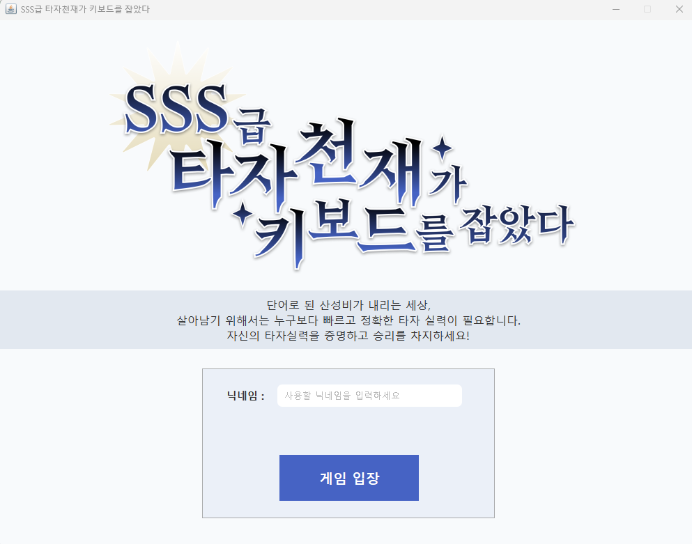
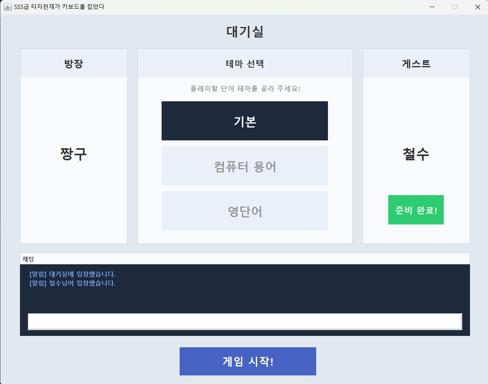
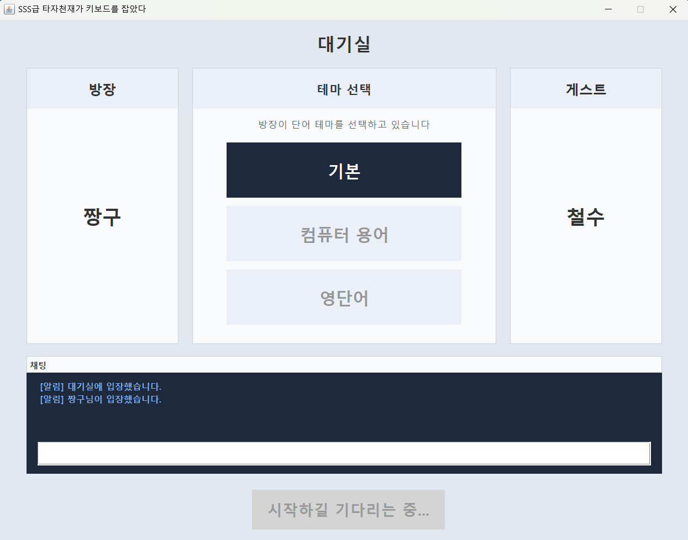
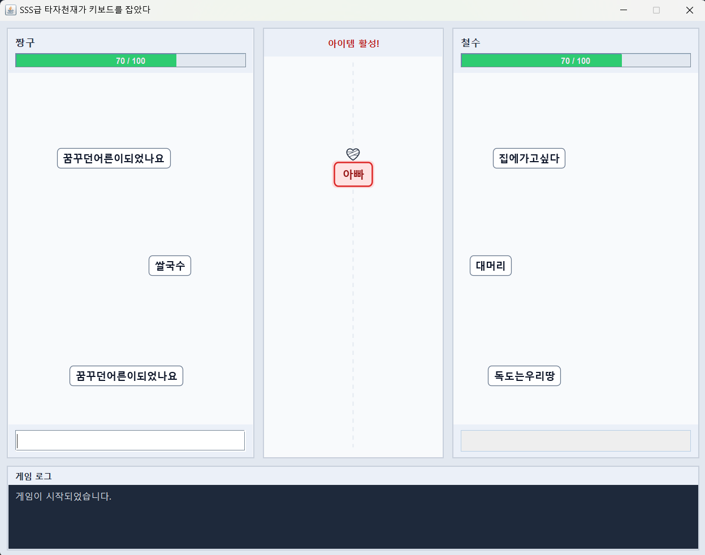
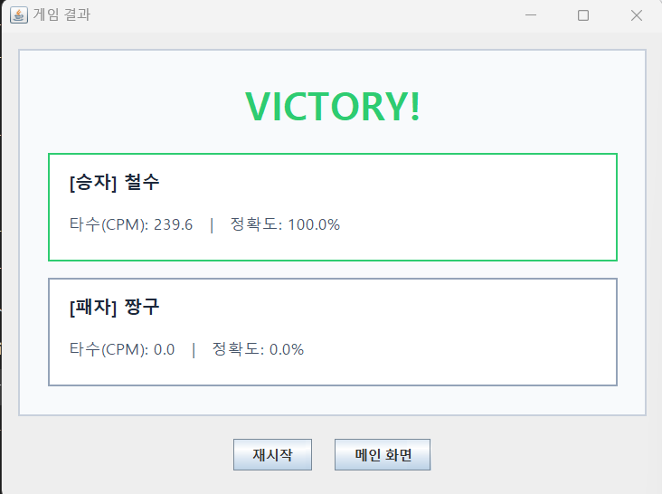
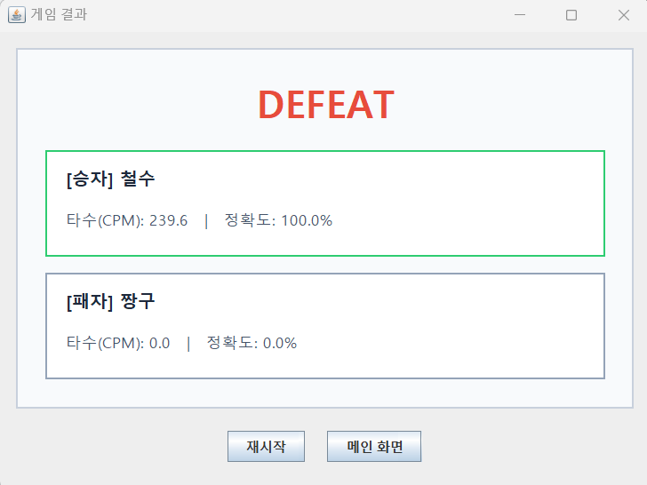
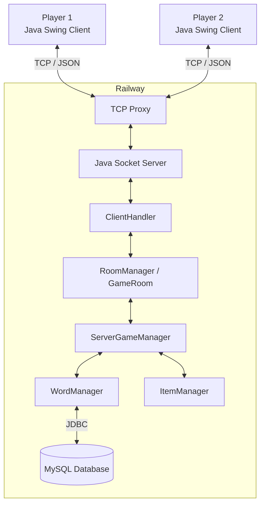

# ⌨️ SSS급 타자천재가 키보드를 잡았다

> 2026 자바프로그래밍및실습2 기말 팀 프로젝트 — **Override**

> 떨어지는 단어를 입력하고, 아이템을 활용해 상대방과 경쟁하는 실시간 1:1 온라인 타자 대전 게임

<p align="center">
  
</p>

<p align="center">
  <a href="https://github.com/leeseeyeon/Override_Acidrain/releases">
    
  </a>
</p>

---

### 🎮 프로젝트 소개

**SSS급 타자천재가 키보드를 잡았다**는 기존 산성비 타자 게임에 실시간 멀티플레이와 아이템 시스템을 결합한 1:1 온라인 타자 대전 게임입니다.

플레이어는 화면에 낙하하는 단어를 입력하여 자신의 체력을 유지하고, 중앙에 등장하는 아이템 단어를 상대방보다 먼저 입력하여 대전에서 유리한 효과를 얻을 수 있습니다.

Java Swing 기반 클라이언트와 Java Socket 기반 서버로 구현하였으며, 게임 서버와 데이터베이스를 Railway에 배포하여 서로 다른 네트워크에서도 실시간 대전이 가능합니다.

---

### ✨ 핵심 기능

- 👥 **실시간 1:1 온라인 대전** — TCP 소켓 기반 멀티플레이
- 💬 **게임 대기실** — 닉네임 설정, 자동 방 배정, 채팅 및 준비 상태 관리
- 📚 **테마별 단어 제공** — 기본 단어, 컴퓨터공학 용어, 영단어
- ⌨️ **실시간 타자 입력** — 낙하 단어 입력 및 서버 기반 판정
- ⚡ **단계별 난이도 증가** — 30초마다 낙하 속도 증가, 최대 5단계
- 💣 **선착순 아이템 시스템** — 공격, 회복 및 시야 방해 효과
- ❤️ **실시간 게임 상태 관리** — 플레이어 HP, 낙하 단어, 아이템 및 게임 로그 동기화
- 🏆 **게임 결과 분석** — 승패, 타수 및 정확도 확인
- 🔄 **재대전 기능** — 게임 종료 후 대기실 복귀 및 재대전
- 🌐 **원격 서버 배포** — 별도의 로컬 서버 실행 없이 온라인 대전 가능
- 📦 **독립 실행 프로그램 제공** — JAR 및 Windows 실행 프로그램 배포

---

### 📥 다운로드 및 실행

[**GitHub Releases**](https://github.com/leeseeyeon/Override_Acidrain/releases)에서 최신 버전을 다운로드할 수 있습니다.

| 배포 파일 | 실행 방법 | 필요 환경 |
| --- | --- | --- |
| `AcidRain-Windows-v1.0.0.zip` | 압축 해제 후 `AcidRain.exe` 실행 | Windows |
| `AcidRain.jar` | `java -jar AcidRain.jar` | Java 21 이상 |

#### 1. Windows 실행 프로그램 (권장)

별도의 Java, Eclipse, Maven 설치 없이 실행할 수 있습니다.

1. `AcidRain-Windows-v1.0.0.zip` 다운로드
2. ZIP 파일 압축 해제
3. `AcidRain.exe` 실행
4. 닉네임 입력 후 게임 접속

> **Windows SmartScreen 보안 경고 안내**
>
> 본 프로그램은 코드 서명 인증서가 적용되지 않은 학생 개발 프로젝트이므로 최초 실행 시 Windows SmartScreen 보안 경고가 표시될 수 있습니다.
>
> 공식 GitHub Releases에서 다운로드한 파일임을 확인한 후 **추가 정보 → 실행**을 선택해 주세요.
>
> `AcidRain.exe`는 함께 제공되는 `app`, `runtime` 폴더가 있어야 실행되므로 실행 파일만 별도로 이동하지 않도록 주의해 주세요.

#### 2. JAR 파일 실행

Java 21 실행 환경이 필요합니다.

```bash
java -jar AcidRain.jar
```

게임 서버 및 데이터베이스는 Railway에 배포되어 있으므로 별도의 서버 실행이나 데이터베이스 설정은 필요하지 않습니다.

온라인 대전을 위해 인터넷 연결이 필요합니다.

---

### 🕹️ 게임 진행 방법

#### 게임 규칙

1. 닉네임을 입력하면 자동으로 방이 배정됩니다.
2. 먼저 접속한 플레이어가 방장이 됩니다.
3. 대기실에서 채팅, 단어 테마 선택 및 준비를 진행합니다.
4. 게임 시작 후 3초 카운트다운이 진행됩니다.
5. 화면에 낙하하는 단어를 입력하고 Enter를 누르면 단어가 제거됩니다.
6. 단어가 바닥에 도달하면 플레이어의 HP가 감소합니다.
7. 30초마다 낙하 속도가 증가합니다.
8. HP가 먼저 0이 되는 플레이어가 패배합니다.

#### 단어 테마

| 테마 | 내용 |
| --- | --- |
| 기본 | 일상생활에서 사용하는 일반 단어 |
| 컴퓨터 용어 | 자료구조, 알고리즘, 프로그래밍 등 CS 관련 용어 |
| 영단어 | 다양한 난이도의 영어 단어 |

#### 아이템

화면 중앙에 등장하는 아이템 단어를 먼저 입력하면 해당 아이템의 효과가 적용됩니다.

| 아이템 | 효과 |
| :---: | --- |
| 💣 BOMB | 상대방 HP 10 감소 |
| 💚 HEAL | 자신의 HP 10 회복 (최대 100) |
| 🌑 SHADOW | 상대방 화면을 4.5초 동안 가림 |

---

### 🎬 시연 영상

<!-- 여기에 GitHub 편집 화면에서 mp4 파일을 끌어다 놓으면 영상 주소가 자동으로 들어갑니다 -->
https://github.com/user-attachments/assets/99ac41fc-7fdf-465c-81ed-f3af1ee08e84

---

### 🖼️ 게임 화면

<table>
  <tr align="center">
    <th width="50%">대기실 (방장)</th>
    <th width="50%">대기실 (게스트)</th>
  </tr>
  <tr align="center">
    <td></td>
    <td></td>
  </tr>
  <tr align="center">
    <th colspan="2">실시간 대전 화면</th>
  </tr>
  <tr align="center">
    <td colspan="2"></td>
  </tr>
  <tr align="center">
    <th>게임 결과 (승리)</th>
    <th>게임 결과 (패배)</th>
  </tr>
  <tr align="center">
    <td></td>
    <td></td>
  </tr>
</table>

> \* 본 게임 진행 사진은 배포 전 테스트용 사진으로, 현재 단어 목록과 차이가 있을 수 있습니다.

---

### 🛠 기술 스택

<table>
  <tr>
    <th align="center">Language / Client</th>
    <th align="center">Server / Database</th>
    <th align="center">Build / Deployment</th>
    <th align="center">Collaboration</th>
  </tr>
  <tr>
    <td valign="top" align="center">
      <br />
      <br />
      
    </td>
    <td valign="top" align="center">
      <br />
      <br />
      <br />
      <br />
      <br />
      
    </td>
    <td valign="top" align="center">
      <br />
      <br />
      <br />
      <br />
      
    </td>
    <td valign="top" align="center">
      <br />
      <br />
      
    </td>
  </tr>
</table>

---

### 🏗 시스템 아키텍처



- 서버 중심의 게임 상태 관리 구조
- 클라이언트별 연결 및 메시지 처리
- 서버에서 단어 생성, 낙하 시간, 입력 판정 및 아이템 효과 관리
- 게임 상태 업데이트를 통한 클라이언트 화면 동기화
- JDBC 기반 테마별 단어 데이터 조회
- Railway TCP Proxy를 통한 외부 네트워크 접속

---

### 🔍 핵심 기술 구현

#### 🖧 서버 · 네트워크

**1. 서버 중심 게임 상태 관리**

클라이언트는 입력한 단어만 서버로 보내고, 단어 판정·HP 변화·아이템 효과·승패는 모두 서버에서 결정합니다.
서버는 `ScheduledExecutorService`로 **50ms마다** 게임 상태를 갱신하고 두 클라이언트에 같은 상태를 전송하여, 두 플레이어의 화면이 항상 일치하도록 했습니다.
게임 시작 카운트다운도 서버와 클라이언트가 같은 설정값(`GameConfig.START_COUNTDOWN_SECONDS`)을 사용해 시작 시점을 맞춥니다.

**2. 클라이언트 연결 및 방 관리**

- 접속한 클라이언트마다 `ClientHandler` 스레드를 생성하여 독립적으로 메시지를 처리합니다.
- `RoomManager`가 빈 자리가 있는 방을 찾아 자동으로 배정하고, 비어 있는 방은 삭제합니다.
- `GameRoom`의 상태 변경 메서드를 `synchronized`로 처리하여 여러 스레드가 동시에 접근해도 방 상태가 꼬이지 않도록 했습니다.
- 방장이 나가면 남은 참가자에게 방장 역할을 넘기고, 연결이 끊긴 경우에도 상대방에게 퇴장을 알립니다.

**3. 확장 가능한 메시지 프로토콜**

모든 메시지는 `type` 필드를 가진 JSON 한 줄로 주고받습니다.
`MessageType` enum이 각 타입에 해당하는 메시지 클래스를 함께 가지고 있어, `JsonUtil`이 `type`만 보고 알맞은 클래스로 변환합니다.
새 메시지를 추가할 때 enum에 한 줄을 추가하고 메시지 클래스만 만들면 되도록 구성했습니다.

#### 🎯 게임 로직 · 데이터베이스

**4. 선착순 아이템 동시성 제어**

두 플레이어가 같은 아이템 단어를 거의 동시에 입력하는 경쟁 상태(Race Condition)를 막기 위해 아이템 처리 메서드를 `synchronized`로 구현했습니다.
먼저 획득 처리된 플레이어에게만 효과가 적용됩니다.

**5. 문자열 기반 입력 판정**

`WORD_SUBMIT` 메시지에는 단어 ID 대신 입력 문자열을 담아 보냅니다.

- 아이템 단어를 먼저 검사하고, 아니면 일반 단어를 검사
- 같은 문자열의 단어가 여러 개 있으면 **바닥 도달 예정 시각이 가장 빠른 단어**부터 제거
- 이미 완료했거나 바닥에 도달한 단어는 판정에서 제외

**6. 인터페이스 기반 확장 구조**

- 아이템 효과는 `ItemEffect` 인터페이스(`BombEffect`, `HealEffect`, `ShadowEffect`)로 분리하고 `ItemFactory`에서 생성합니다.
- 승패 판정은 `WinCondition` 인터페이스(`HpZeroWinCondition`)로 분리했습니다.
- 단어 데이터는 `WordRepository` 인터페이스로 접근하여, DB 구현체(`DBWordRepository`)를 다른 방식으로 쉽게 바꿀 수 있습니다.

**7. 데이터베이스 연동**

테마별 단어를 MySQL에 저장하고, 게임 시작 시 선택된 테마의 단어를 JDBC로 무작위 조회(`ORDER BY RAND()`)하여 매 게임 다른 단어가 나오도록 했습니다.
DB 접속 정보는 환경변수로 관리합니다.

**8. 게임 로그 전송 최적화**

게임 로그는 최근 20개만 유지하고, 초과하면 가장 오래된 로그부터 제거합니다.
게임이 길어져도 로그 전송량과 클라이언트의 로그 비교 비용이 일정 크기 이상 늘어나지 않습니다.

#### 🖥️ 클라이언트

**9. 서버 상태 기반 화면 동기화**

- `GameClientModel`이 서버에서 받은 상태를 보관하고, 단어·플레이어 상태가 **실제로 바뀐 경우에만** 화면 갱신을 알립니다. (옵저버 패턴, `GameModelListener`)
- 서버 좌표(필드 높이 `GameConfig.FIELD_HEIGHT`)를 화면 크기에 맞는 비율로 변환해 그리므로, 창 크기와 관계없이 같은 위치에 단어가 표시됩니다.
- 네트워크 수신 스레드에서 받은 메시지는 `SwingUtilities.invokeLater`로 Swing 이벤트 스레드(EDT)에 넘겨 화면을 안전하게 갱신합니다.
- SHADOW 아이템을 맞은 플레이어의 보드에 일정 시간 가림 효과를 표시합니다.

**10. 역할 기반 대기실 UI**

- 방장과 참가자의 버튼 동작을 `LobbyRole` 인터페이스(`HostRole`, `GuestRole`)로 분리했습니다. 방장은 테마 선택·게임 시작, 참가자는 준비를 할 수 있습니다.
- `LobbyModel`의 상태가 바뀌면 `LobbyModelListener`를 통해 화면이 자동으로 갱신됩니다.
- 화면 전환은 `ScreenNavigator` 인터페이스로 분리하여, 게임 후 대기실로 돌아갈 때 상대·역할·채팅을 유지합니다.
- 닉네임은 한글·영문·숫자 10자 이내로 검증합니다.

#### ⚙️ 공통 · 배포

**11. 공통 설정 및 타입 관리**

`common` 패키지에서 서버와 클라이언트가 함께 쓰는 설정값, 메시지, 타입을 관리하여 양쪽의 기준이 어긋나지 않도록 했습니다.

- `GameConfig` — 필드 크기, 최대 HP, 카운트다운 시간
- `NetworkConfig` — 서버 포트 및 접속 주소
- `Theme`, `ItemType`, `Role` — 공통 Enum 타입

**12. 서버 배포 및 클라이언트 패키징**

- Docker 멀티 스테이지 빌드로 서버의 빌드 환경과 실행 환경을 분리했습니다.
- Railway에 게임 서버와 MySQL을 배포하고 TCP Proxy로 외부 접속을 열었습니다.
- 클라이언트는 Maven Shade Plugin으로 실행 가능한 JAR을 만들고, jpackage로 Java 실행 환경이 포함된 Windows 실행 프로그램을 제공합니다.

---

### 👥 팀원 소개

<table>
  <tr align="center">
    <th width="25%">이시연</th>
    <th width="25%">박채원</th>
    <th width="25%">편채영</th>
    <th width="25%">윤영</th>
  </tr>
  <tr align="center">
    <td><b>Team Leader<br/>Server / Network</b></td>
    <td><b>Server Game Logic<br/>Database / Deployment</b></td>
    <td><b>Client Game<br/>Game UI</b></td>
    <td><b>Client UI<br/>Start / Lobby</b></td>
  </tr>
  <tr align="center">
    <td valign="top">
      <b>[ 서버 네트워크 ]</b><br />
      TCP 소켓 통신<br />
      클라이언트 연결 관리<br />
      방 및 세션 관리<br />
      게임 진행 타이머<br /><br />
      <b>[ 프로토콜 ]</b><br />
      메시지 구조 설계<br />
      서버·클라이언트 통신 연동<br /><br />
      <b>[ 배포 ]</b><br />
      Railway 서버 연동<br />
      TCP Proxy 설정<br /><br />
      <b>[ 프로젝트 관리 ]</b><br />
      팀 프로젝트 일정 및 협업 관리
    </td>
    <td valign="top">
      <b>[ 서버 게임 로직 ]</b><br />
      단어 생성 및 낙하 관리<br />
      문자열 기반 입력 판정<br />
      아이템 생성 및 효과 적용<br />
      플레이어 HP 및 승패 판정<br />
      타수·정확도 계산<br />
      게임 로그 전송 최적화<br /><br />
      <b>[ 데이터베이스 ]</b><br />
      DB 구조 설계 및 구축<br />
      JDBC 연동<br />
      테마별 단어 데이터 관리<br />
      Railway MySQL 배포<br /><br />
      <b>[ 배포·패키징 ]</b><br />
      Docker 환경 구성<br />
      DB 데이터 이전<br />
      JAR 및 EXE 패키징<br />
      GitHub Releases 배포
    </td>
    <td valign="top">
      <b>[ 게임 화면 ]</b><br />
      플레이어별 게임 보드<br />
      낙하 단어 시각화<br />
      HP 및 아이템 표시<br />
      게임 로그 UI<br /><br />
      <b>[ 게임 상태 관리 ]</b><br />
      서버 상태 데이터 반영<br />
      사용자 입력 처리<br />
      게임 화면 갱신<br /><br />
      <b>[ 결과 화면 ]</b><br />
      승패 결과 표시<br />
      타수 및 정확도 표시
    </td>
    <td valign="top">
      <b>[ 시작 화면 ]</b><br />
      시작 화면 UI<br />
      닉네임 입력 및 검증<br />
      서버 접속 화면<br /><br />
      <b>[ 대기실 ]</b><br />
      채팅 UI<br />
      준비 상태 표시<br />
      테마 선택<br />
      게임 시작 카운트다운<br /><br />
      <b>[ 화면 관리 ]</b><br />
      메인 프레임 구성<br />
      화면 전환 및 UI 연동
    </td>
  </tr>
</table>

---

### 📁 폴더 구조

```text
Override_Acidrain/
├── src/
│   ├── main/
│   │   ├── java/
│   │   │   ├── client/
│   │   │   │   ├── start/       # 시작 화면 및 닉네임 입력
│   │   │   │   ├── lobby/       # 대기실, 채팅, 준비, 테마 선택
│   │   │   │   ├── game/        # 게임 화면 및 상태 관리
│   │   │   │   ├── result/      # 게임 결과 화면
│   │   │   │   ├── network/     # 서버 연결 및 메시지 수신
│   │   │   │   └── ui/          # 메인 프레임 및 화면 전환
│   │   │   ├── server/
│   │   │   │   ├── network/     # 서버 실행 및 연결 관리
│   │   │   │   ├── room/        # 게임방 및 세션 관리
│   │   │   │   ├── game/        # 서버 게임 로직
│   │   │   │   │   ├── word/    # 단어 생성 및 입력 판정
│   │   │   │   │   ├── item/    # 아이템 생성 및 효과 관리
│   │   │   │   │   ├── player/  # 플레이어 상태 및 타자 기록
│   │   │   │   │   ├── rule/    # 승패 판정 규칙
│   │   │   │   │   └── session/ # 게임 세션 및 상태
│   │   │   │   └── db/          # DB 연결 관리
│   │   │   └── common/
│   │   │       ├── config/     # 공통 설정값
│   │   │       ├── dto/        # 데이터 전송 객체
│   │   │       ├── message/    # 통신 메시지
│   │   │       └── type/       # 공통 Enum 타입
│   │   └── resources/         # 이미지 및 실행 리소스
├── docs/
│   └── images/                 # README 스크린샷
├── database/
│   └── backup.sql              # 단어 DB 백업 (로컬 DB 생성용)
├── Dockerfile                  # Railway 서버 빌드 및 실행 환경
├── .dockerignore
├── .gitignore
├── pom.xml                     # Maven 의존성 및 빌드 설정
└── README.md
```

---

### 📡 통신 프로토콜

서버와 클라이언트는 `type` 필드를 포함한 JSON 메시지를 TCP 소켓을 통해 주고받습니다.

#### 메시지 예시

```json
{
  "type": "WORD_SUBMIT",
  "word": "사과",
  "typingTime": 1.25
}
```

#### 주요 메시지

| 단계 | 메시지 타입 |
| --- | --- |
| 접속 | `JOIN`, `JOINED`, `ROLE`, `OPPONENT`, `OPPONENT_LEFT`, `ERROR` |
| 대기실 | `CHAT`, `READY`, `THEME`, `START` |
| 게임 | `GAME_START`, `WORD_SUBMIT`, `GAME_STATE_UPDATE`, `GAME_FINISHED`, `GAME_QUIT` |

---

### 🚀 개발 환경에서 실행하기

#### 1. 요구 환경

- JDK 21
- Maven
- MySQL 또는 MariaDB (로컬 서버 실행 시)

#### 2. 저장소 및 프로젝트 빌드

```bash
git clone https://github.com/leeseeyeon/Override_Acidrain.git
cd Override_Acidrain
mvn clean package
```

#### 3. 클라이언트 실행

```bash
java -jar target/acid-rain-0.0.1-SNAPSHOT-client.jar
```

클라이언트 실행 클래스는 `client.ui.MainFrame`입니다.

기본 접속 주소는 Railway에 배포된 서버로 설정되어 있습니다.

#### 4. 로컬 서버 실행

로컬 환경에서 서버를 직접 실행하는 경우 다음 설정이 필요합니다.

| 항목 | 설정값 |
| --- | --- |
| 서버 실행 클래스 | `server.network.ServerMain` |
| 클라이언트 실행 클래스 | `client.ui.MainFrame` |
| 서버 내부 포트 | `50023` |
| DB 초기화 파일 | `database/backup.sql` |

DB 접속 환경변수를 설정합니다.

```dotenv
DB_URL=jdbc:mysql://localhost:3306/데이터베이스명
DB_USER=사용자명
DB_PASSWORD=비밀번호
```

`common/config/NetworkConfig.java`의 접속 정보를 로컬 서버에 맞게 변경합니다.

```java
public static final int LISTEN_PORT = 50023;
public static final String SERVER_IP = "127.0.0.1";
public static final int SERVER_PORT = 50023;
```

Eclipse에서 `server.network.ServerMain`을 실행한 후 `client.ui.MainFrame`을 실행합니다.

---

### 📦 클라이언트 패키징

Maven Shade Plugin을 활용하여 실행 가능한 클라이언트 JAR 파일을 생성합니다.

```bash
mvn clean package -DskipTests
```

생성된 클라이언트 JAR 파일:

```text
target/acid-rain-0.0.1-SNAPSHOT-client.jar
```

Windows 실행 프로그램은 Java 21의 jpackage를 활용하여 생성합니다.

```bash
mkdir -p packaging/input

cp target/acid-rain-0.0.1-SNAPSHOT-client.jar packaging/input/AcidRain.jar

jpackage --type app-image --name AcidRain --input packaging/input --main-jar AcidRain.jar --main-class client.ui.MainFrame --dest dist --app-version 1.0.0
```

#### 패키징 결과

```text
dist/
└── AcidRain/
    ├── AcidRain.exe
    ├── app/
    └── runtime/
```

생성된 `AcidRain` 폴더 전체를 ZIP 파일로 압축하여 배포합니다.

---

### 🤝 협업 방식

- GitHub Issues를 활용한 기능 및 오류 관리
- 기능별 브랜치를 통한 독립적인 개발
- Pull Request 기반 코드 리뷰
- develop 브랜치를 중심으로 코드 통합
- UML 클래스 다이어그램 기반 객체지향 설계
- 통신 프로토콜 명세 기반 서버·클라이언트 협업

---

### 🔗 배포 링크

| 구분 | 링크 |
| --- | --- |
| GitHub Repository | [Override_Acidrain](https://github.com/leeseeyeon/Override_Acidrain) |
| 게임 다운로드 | [GitHub Releases](https://github.com/leeseeyeon/Override_Acidrain/releases) |
| 게임 서버 | Railway |
| 데이터베이스 | Railway MySQL |

---

<p align="center">
  <b>2026 Java Programming & Practice II</b><br/>
  Team Override
</p>


